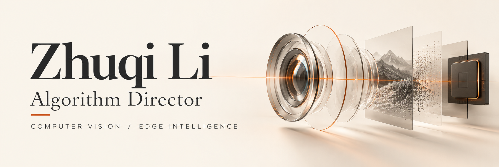

  

  <strong>Computer Vision · Human Motion · Edge AI</strong> 
  计算机视觉 · 人体运动理解 · 端侧智能

  <a href="https://orcid.org/0009-0006-1395-0269">ORCID</a>
  &nbsp; / &nbsp;
  <a href="#selected-publications--代表论文">Publications</a>
  &nbsp; / &nbsp;
  <a href="https://github.com/lizhuqi233?tab=repositories">Repositories</a>

---

### About me · 关于我

I'm **Zhuqi Li (李柱奇)**, an **Algorithm Director** based in Shenzhen. I build computer vision systems for sports: from RGB-D capture and motion-capture alignment to human pose estimation, ball tracking, and real-time inference on edge devices.

My work spans model development and the systems around it—data quality, deployment, runtime services, and the applications that turn model outputs into useful feedback. I previously interned at **Hikvision** and completed my master's studies at **Northeast Forestry University**.

目前在**深圳市投篮数科体育科技有限公司**担任**算法总监**，负责 SHOTLAB 运动视觉算法与系统研发。工作涵盖篮球轨迹与结果识别、人体三维姿态和动作分析、RGB-D 与光学动捕数据对齐，以及 RK3588、QCS8550 端侧部署，支持了 30 余套运动分析系统落地。

### Selected work · 代表工作

**Sports perception & analysis / 篮球多模态感知与分析**  
Built server-side pipelines for ball trajectories, shot outcomes, shooter localization, and court heatmaps. Combined RGB and RGB-D human-motion analysis with four action phases and twelve assessment metrics, linking results and replay clips through a per-shot identifier.

**Two generations of edge systems / 两代端侧分析系统**  
Developed an RK3588 system using RealSense, RKNN, RTMPose, and temporal 3D pose estimation, then implemented a QCS8550 version with QNN. Work included model conversion, numerical and preprocessing consistency, capture/inference scheduling, and service integration. Migrated the ball-result and human-action pipelines from server environments as separate components.

**RGB-D & optical motion capture / 数据采集与时空标定**  
Built recording, synchronization, calibration, and review tools for RGB-D cameras and 240 Hz optical motion capture. Used shared events to estimate clock offset and drift, tracked RGB and depth timestamps separately, and preserved validity masks and provenance in exported ground-truth data.

**Depth-aware 3D human pose / 真实深度与时序姿态研究**  
Explored depth and 2D-confidence fusion for temporal 3D pose estimation, including long-window consistency and causal smoothing. Evaluated methods with explicit validity masks and versioned data splits.

**Training applications / 训练应用与教练原型**  
Connected analysis results to Flutter and UniApp applications with player profiles, replay, and streaming feedback. Prototyped an on-device language-model coach while keeping numerical assessment separate from generated explanations.

### Research interests · 研究方向

- **Human pose & motion:** 3D pose estimation, human reconstruction, sports motion analysis.
- **RGB-D perception:** depth-aware vision, multimodal fusion, motion-capture alignment.
- **Detection & tracking:** object detection, object tracking, multi-object tracking.
- **Efficient vision systems:** lightweight models, edge inference, real-time deployment.

### Selected publications · 代表论文

1. **DAF-MFNet: A Multi-Scale Driving Assistance Detection Algorithm Based on Multi-Modal Fusion.**  
   **Zhuqi Li** et al. · *IJCNN*, 2025. [Paper](https://doi.org/10.1109/IJCNN64981.2025.11229322)

2. **Rice Disease Detection: TLI-YOLO Innovative Approach for Enhanced Detection and Mobile Compatibility.**  
   **Zhuqi Li** et al. · *Sensors*, 25(8), 2494, 2025. [Paper](https://doi.org/10.3390/s25082494)

3. **Lightweight PCB defect detection algorithm and deployment based on ASF-YOLO.**  
   **Zhuqi Li** et al. · *CISAT*, 2024. [Paper](https://doi.org/10.1109/CISAT62382.2024.10695334)

### Experience & education · 经历与教育

| Role | Institution | Focus |
| :--- | :--- | :--- |
| **Algorithm Director / 算法总监** | 深圳市投篮数科体育科技有限公司 | Sports vision, real-time systems, edge deployment |
| **Algorithm Intern / 算法实习生** · 2024.06–2024.12 | Hikvision / 海康威视 | Depth estimation, semantic segmentation, Jetson deployment |
| **Master's / 硕士** · 2023–2026 | Northeast Forestry University / 东北林业大学 | 计算机与人工智能学院 |

### Tools I work with · 技术栈

**Models & data** — Python, C, PyTorch, OpenCV, RGB-D, optical motion capture  
**Deployment & systems** — ONNX, RKNN, QNN, RK3588, QCS8550, Linux, Docker, ROS  
**Applications** — Flutter, UniApp, REST, WebSocket, SQLite

---

**ORCID** · [0009-0006-1395-0269](https://orcid.org/0009-0006-1395-0269)  
Open to discussions on computer vision, human motion, and deploying vision systems in practice.
