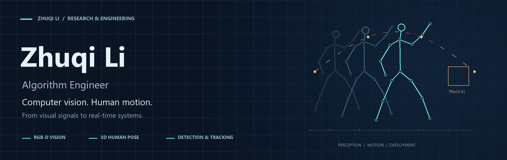

  

  <strong>Computer Vision · Human Motion · Real-time Systems</strong> 
  计算机视觉 · 人体运动理解 · 实时系统

  <a href="https://orcid.org/0009-0006-1395-0269">ORCID</a>
  &nbsp; / &nbsp;
  <a href="https://github.com/lizhuqi233?tab=repositories">Repositories</a>

---

### About me · 关于我

I'm **Zhuqi Li (李柱奇)**, an algorithm engineer based in Shenzhen. My interests include human pose estimation, RGB-D vision, object detection and tracking, and bringing vision models into real-time applications.

I completed my master's studies at **Northeast Forestry University** (2023–2026).

我是李柱奇，目前在**深圳市投篮数字科技有限责任公司**担任算法工程师。硕士毕业于**东北林业大学计算机与人工智能学院**（2023–2026）。主要关注人体姿态与运动分析、目标检测与跟踪，以及视觉算法的实时部署。

### Research interests · 研究兴趣

| Area | Topics |
| :--- | :--- |
| **Human pose & motion** | 3D human pose estimation, human reconstruction, sports motion analysis |
| **RGB-D perception** | Depth-aware vision, motion capture, multimodal data alignment |
| **Detection & tracking** | Object detection, object tracking, multi-object tracking |
| **Real-time vision** | Edge AI, model deployment, efficient inference |

### Background · 经历

- **Algorithm Engineer** — 深圳市投篮数字科技有限责任公司 · Shenzhen, China
- **Master's studies, 2023–2026** — Northeast Forestry University · 哈尔滨，中国

### Research profile · 学术档案

**ORCID:** [0009-0006-1395-0269](https://orcid.org/0009-0006-1395-0269)

Interested in exchanging ideas on computer vision, human motion, and practical vision systems.
